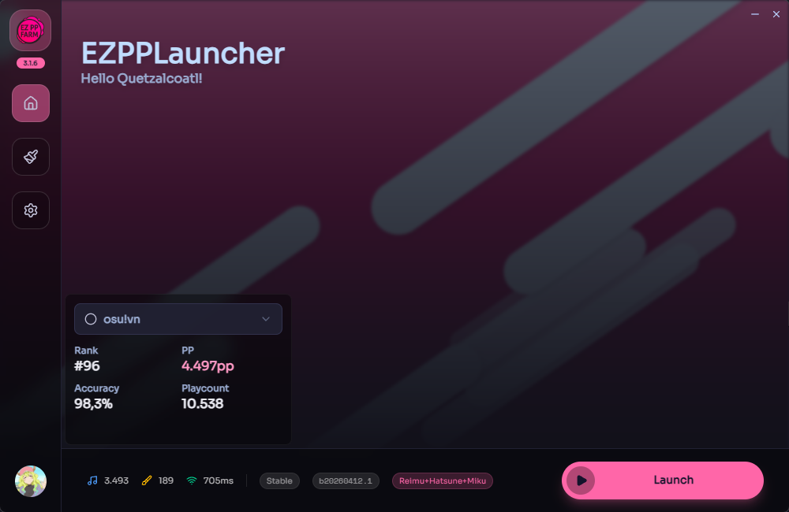

# EZPPLauncher

**EZPPLauncher** is a modern, feature-rich custom launcher for the private osu! server [EZPPFarm](https://ez-pp.farm), built with **Rust** and **Svelte 5** using the [Tauri](https://tauri.app) framework.  
It enhances the osu! experience with quality-of-life features, advanced launcher theming, customized Discord Rich Presence, and seamless server integration. Windows and macOS are supported, with partial support for Linux.

---

## 🖼️ Preview



---

## 🚀 Features

### Game & Server Integration

- [x] **Direct Server Launch**: Launches osu! directly with `-devserver ez-pp.farm`, bypassing osu! updater loops and preserving launch parameters.
- [x] **Automatic In-Game Login**: Automatically signs into your EZPPFarm account upon game boot.
- [x] **In-Game Relax & Autopilot Miss Patcher**: Injects a hook into the osu! client to display misses in Relax and Autopilot modes (Windows, macOS via Wine, and partially on Linux via osu-winello).
- [x] **Live Player Stats**: Displays rank, PP, accuracy, playcount, and server latency directly on the launcher dashboard.
- [x] **Library Indexing**: Automatically counts imported beatmapsets and skins.
- [x] **OpenTabletDriver Integration**: Automatically starts and stops the OpenTabletDriver daemon on launch/exit (Windows only).
- [x] **Competitive Game Optimization Mode**: Optional low-latency engine setting that boosts osu! process priority to High and requests sub-millisecond Windows timer resolution (1ms) during gameplay.
- [x] **Performance Display Overlay**: In-game HUD overlay (available in the experimental patcher stream).

### Visual Theme Engine v2 & In-App Studio

- [x] **Declarative Theme API 2.0**: Modern JSON schema supporting background videos, audio, Lottie animations, and layered widgets without custom compilation.
- [x] **Dedicated Visual Theme Editor**: Standalone resizable window with a full-featured visual canvas, live preview, and multi-element selection.
- [x] **Custom Svelte 5 Component Layers**: Embed custom reactive Svelte 5 components with an integrated **Monaco code editor** and live compiler diagnostics.
- [x] **Canvas Transform Tooling**: Multi-selection, snapping, freeform rotation, X/Y scale, skew, and group breadcrumb navigation.
- [x] **Logic & Scripting System**: Visual WHEN/IF/THEN rule builder and sandboxed rule scripting (expressions, branches, loops, visibility toggles) without `eval`.
- [x] **Dynamic Placeholders & Clock Expressions**: Real-time variables (`{username}`, `{rank}`, `{pp}`) and second-accurate clock variables (`{time}`, `{hour}`, `{minute}`).
- [x] **Typography & Icon Families**: Gradient fills, outlines, drop shadows, custom `@fontsource` webfonts, and bundled Lucide, Phosphor, and Tabler icon catalogs.
- [x] **Dynamic Particle Emitters & 3D Cursor Parallax**: Configurable background particles (snow, stars, petals, bubbles, and floating embers) plus smooth cursor-driven 3D parallax depth for layers and backgrounds.
- [x] **Backup & Rollback System**: Automatic versioned theme snapshots with one-click restoration, plus security trust prompts for executable components.

### Discord Rich Presence Studio

- [x] **Dedicated Presence Editor Window**: In-app studio to customize your Discord presence.
- [x] **Interactive Discord Embed Preview**: Real-time visual mockup mirroring Discord's user profile popout card.
- [x] **Dynamic Placeholders**: Interpolate live stats (`{username}`, `{rank}`, `{pp}`, `{accuracy}`, `{playcount}`, `{version}`) into details, state, and asset tooltips.
- [x] **Custom Action Buttons & Presets**: Configurable buttons linking to player profiles, leaderboards, or custom URLs, plus quick presets (Default, Grinding, Competitive, Relax, AFK).

### Diagnostics, Logging & System Tools

- [x] **In-App Diagnostics Panel**: Validates osu! folder integrity, write permissions, Wine runtimes, .NET 8 desktop runtime, FFmpeg, and patcher status.
- [x] **Multi-Stream Log Viewer**: Dedicated rotating logs (`launcher.log`, `osu.log`, `patcher.log`) with session bundling, zip archive export, and an in-app viewer.
- [x] **macOS Wine Automation**: Automatic font registry sanitization (eliminating GDI+ `AccessViolationException` crashes), Wine prefix management, and automated in-place patcher bytecode patching for .NET 4.0 runtimes under Wine.
- [x] **Hardware-Accelerated Media Server**: Local HTTP range streaming server on macOS and Linux for smooth, low-memory WebM and MP4 video playback.

---

## 💻 Supported Platforms

| Platform | Status                 | Runtime / Environment                                      |
| -------- | ---------------------- | ---------------------------------------------------------- |
| Windows  | ✅ Supported           | Native Win32                                               |
| macOS    | ✅ Supported           | Wine wrapper (Wineskin, Whisky, CrossOver, or system Wine) |
| Linux    | 🕧 Partially Supported | Wine / Proton (via osu-winello / wmctrl)                   |

> **Windows** and **macOS** are fully supported. **Linux is partially supported**: osu! must be managed through external community tooling ([`osu-winello`](https://github.com/NelloKudo/osu-winello)), window tracking requires `wmctrl`, OpenTabletDriver automation is unavailable, and the launcher is restricted to the stable patcher stream.

---

### 🍎 macOS Integration Details

osu! stable is a 32-bit Windows application, so on macOS it runs inside a Wine-based wrapper. EZPPLauncher natively supports **Wineskin wrappers** (the standard `osu!.app` bundle), **Whisky bottles**, and **CrossOver bottles**.

- **Automatic Wrapper Detection**: The setup wizard automatically searches `/Applications` and `~/Applications` for existing Wineskin bundles and Wine prefixes. If choosing **Browse**, selecting the `osu!.app` bundle directly resolves the underlying prefix without needing to navigate inside "Show Package Contents".
- **Wine Prefix Font Fix**: macOS system font enumeration under Wine GDI+ can crash osu! on cold start with an `AccessViolationException` when reading Apple Braille fonts. EZPPLauncher automatically detects and cleans incompatible font entries from the prefix registry (`user.reg` / `system.reg`).
- **Updater Loop Prevention**: Abnormal game exits can leave behind `.require_update`, `help.txt`, or `_pending` folders that cause `osu!.exe` to boot into the Bancho updater and lose command-line parameters. The launcher purges these markers before launch to ensure the `-devserver ez-pp.farm` flag is always preserved.
- **Automated Patcher Bytecode Patching**: The Windows patcher (`osu!.patcher.exe`) targets .NET 4.5+ and embeds `ManagedInjector.Lib`. In Wine prefixes using the .NET Framework 4.0 runtime, generic `Marshal.SizeOf<T>()` and `Marshal.PtrToStructure<T>()` methods do not exist, and redirected standard I/O causes `Console.ReadKey()` crashes. EZPPLauncher automatically inspects and patches the patcher binary and its embedded Costura assemblies in-place, enabling seamless injection into the running game process under Wine.
- **Hardware-Accelerated Theme Media**: Large VP8/VP9/AV1 theme videos are automatically transcoded to hardware-decoded H.264/AAC. The launcher manages a sandboxed static FFmpeg build in `~/.ezpplauncher/bin` (with fallback to system FFmpeg). Theme assets are served over an internal loopback server supporting HTTP range requests to minimize memory consumption.
- **Native macOS Window Rounding**: Native Cocoa window clipping applies rounded corners and transparent borders to the Tauri window.

---

### 🐧 Linux (Partially Supported)

Linux support is functional but partial, relying on external community tools rather than built-in prefix management:

- **External Tooling Requirements**:
  - **[`osu-winello`](https://github.com/NelloKudo/osu-winello)**: osu! must be installed and managed through osu-winello. EZPPLauncher detects the `osu-wine` binary in standard search locations (`/usr/bin`, `/usr/local/bin`, and `~/.local/bin`).
  - **`wmctrl`**: Required for game process discovery and active window title detection under X11 and XWayland (`sudo pacman -S wmctrl` on Arch or `sudo apt install wmctrl` on Debian/Ubuntu).
- **Feature Limitations**:
  - **OpenTabletDriver**: Automated daemon start/stop is Windows-only. On Linux, run OpenTabletDriver as a user systemd service (`systemctl --user enable --now opentabletdriver.service`).
  - **Patcher Stream**: Linux is constrained to the **stable** patcher stream. The experimental stream (.NET 8 runtime) is not supported on Linux.
  - **Theme Streaming via Loopback**: Tauri uses WebKit2GTK on Linux, which does not support byte-range streaming over custom application URI schemes. EZPPLauncher automatically spins up an internal loopback HTTP server to stream large video/audio theme assets with low memory overhead.

---

## 🎮 Discord Rich Presence Studio

The launcher features an interactive Discord Rich Presence editor accessible from **Settings → Discord Presence**:

- **Live Profile Mockup**: Visualizes your presence card exactly as it appears inside Discord.
- **Stat Placeholders**: Insert live interpolated values:
  - `{username}`: Player display name
  - `{rank}`: Current global rank
  - `{pp}`: Total performance points
  - `{accuracy}`: Overall hit accuracy percentage
  - `{playcount}`: Account playcount
  - `{version}`: Active launcher version
- **Custom Buttons**: Add interactive links (e.g. your EZPPFarm profile or twitch stream).
- **Presence Presets**: One-click presets for default launcher idle, grinding, competitive matches, and relax sessions.

---

## 🎨 Launcher Theming

The launcher supports two theme generations:

- **Theme API 2.0 (Recommended)**: A declarative format described in `theme.json` with assets, audio, Lottie animations, and layered elements.
  - Can be built and edited visually with the **in-app Theme Editor**.
  - Supports custom **Svelte 5 component layers** with Monaco editor integration for rich interactive widgets.
  - Features visual WHEN/IF/THEN rule building or sandboxed JavaScript scripting.
  - Exported as shareable `.ezpplauncher-theme` zip archives.
- **Theme API 1.0**: Standalone bundled Svelte themes compiled via the CLI.

For detailed documentation, schemas, and packaging guides, refer to [THEME_API_V2.md](THEME_API_V2.md).

---

## 🪵 Logs & Diagnostics

Output from the launcher, osu!, and the patcher is organized under `.ezpplauncher/logs` in your user home directory (`%USERPROFILE%\.ezpplauncher\logs` on Windows, `~/.ezpplauncher/logs` on macOS and Linux):

| File           | Source                                                                    |
| -------------- | ------------------------------------------------------------------------- |
| `launcher.log` | Launcher lifecycle, backend commands, webview console and uncaught errors |
| `osu.log`      | osu! game client and updater stdout/stderr                                |
| `patcher.log`  | Patcher stdout/stderr and injection diagnostic messages                   |

- **Session Archiving**: When a new session begins or when any active log file reaches 5 MiB, the active logs are bundled into a compressed `logs_<date>_<time>.zip` archive. The 5 most recent archives are retained.
- **Built-in Log Viewer**: Browse, search, and filter session logs in real time from **Settings → Logging**.
- **System Diagnostics**: Open **Settings → Diagnostics** to run an automated check on your osu! installation, folder permissions, Wine prefix configuration, .NET runtimes, FFmpeg transcoder, and patcher files, with one-click report copying for troubleshooting.

---

## 🛠 Build From Source

### Prerequisites

- **[Rust & Cargo](https://rustup.rs/)** (Rust 2024 edition)
- **[Bun](https://bun.sh/)** (JavaScript runtime and package manager)
- **[CMake](https://cmake.org/download/)**
- Platform tooling:
  - **Windows**: Visual Studio C++ Build Tools
  - **macOS**: Xcode Command Line Tools (`xcode-select --install`)
  - **Linux**: WebKit2GTK, libsoup, and standard build-essential packages

### Build Steps

```bash
# 1. Clone the repository
git clone https://git.ez-pp.farm/EZPPFarm/EZPPLauncher.git
cd EZPPLauncher

# 2. Install dependencies
bun install

# 3. Type check and verify
bun run check

# 4. Build the release binaries
bun run build
```

The compiled release packages will be generated at:

```
# Windows
src-tauri/target/release/ezpplauncher.exe

# macOS
src-tauri/target/release/bundle/macos/EZPPLauncher.app
src-tauri/target/release/bundle/dmg/EZPPLauncher_*.dmg

# Linux
src-tauri/target/release/bundle/deb/
src-tauri/target/release/bundle/appimage/
```

---

## 📁 Project Structure (Overview)

```
EZPPLauncher/
├── src/                               # Frontend application (Svelte 5, Tailwind CSS)
│   ├── lib/
│   │   ├── components/
│   │   │   ├── presence/              # Discord Rich Presence studio & preview
│   │   │   ├── theme/                 # In-app Theme Editor & visual inspectors
│   │   │   └── ui/                    # Reusable UI controls, cursor & dialogs
│   │   ├── themeV2.ts                 # Theme API 2.0 runtime & parsing
│   │   └── osuUtil.ts                 # Game folder detection & system utilities
│   ├── routes/                        # SvelteKit routing & main app views
│   └── screens/                       # Launcher dashboard, setup wizard & loading
├── src-tauri/                         # Backend core (Rust, Tauri v2)
│   ├── src/
│   │   ├── commands.rs                # Tauri IPC invoke commands
│   │   ├── logging.rs                 # Multi-stream rotating logger & zip bundler
│   │   ├── macos.rs                   # macOS Wine/Wineskin runtime & font fixes
│   │   ├── theme_server.rs            # Internal HTTP range server for theme media
│   │   └── utils.rs                   # Patcher .NET 4.0 bytecode compatibility engine
│   ├── Cargo.toml                     # Rust dependencies
│   ├── tauri.conf.json                # Main Tauri configuration
│   └── tauri.macos.conf.json          # macOS bundle configuration
├── THEME_API_V2.md                    # Theme API 2.0 schema specification
├── package.json                       # Bun project dependencies & scripts
└── README.md
```

---

## 📄 License

This project is licensed under the [GNU General Public License v3.0](LICENSE.md).
